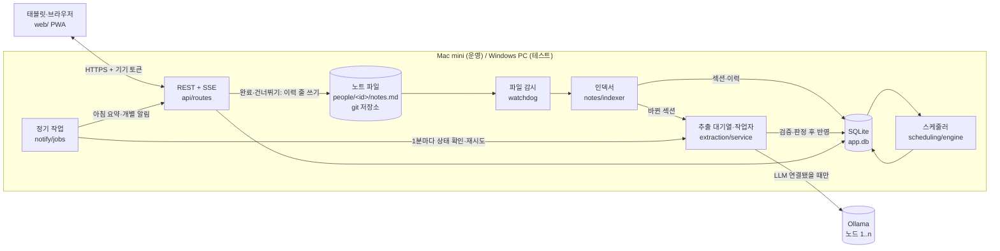
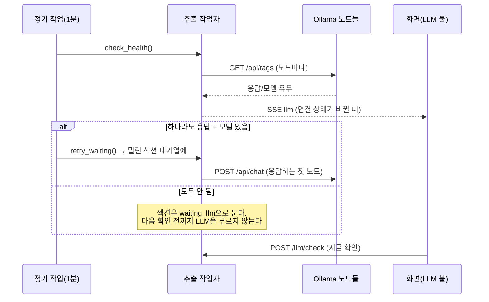

# 아키텍처

지금 코드가 실제로 어떻게 짜여 있는지 적는다(계획이 아니라 현재 상태). 설계 문서와 달라진 이유는 맨 아래
[결정 기록](#10-결정-기록-adr)에, 버전별 변화는 [CHANGELOG.md](CHANGELOG.md)에 있다. 구조를 바꾸면 이 문서와 결정 기록을 같이 고친다.

- 기준 버전: 0.2.2 (2026-10-11)

## 1. 원칙

1. **노트가 원본.** 사람별 Markdown 노트 하나가 단일 원본이고, SQLite는 노트에서 다시 만들 수 있는 인덱스다.
2. **LLM은 읽기만, 날짜는 코드가.** LLM 출력은 규칙과 원문에 적힌 날짜뿐이다. 다음 날짜는 순수 함수(`app/scheduling`)가 계산한다.
3. **사람의 글은 건드리지 않는다.** 앱은 `<!-- history -->` 아래 이력 줄만 쓴다.
4. **LLM이 없어도 돈다.** 분석만 기다리고 나머지(일정, 완료, 알림, 화면)는 그대로.
5. **API 우선.** 화면은 공개된 `/api/v1`만 쓴다. 나중에 앱이 같은 API를 쓴다.

## 2. 구성



위 줄이 "노트 → 분석 → 일정", 아래 줄이 "완료하면 API가 노트에 이력 줄을 쓰고 다시 읽는" 되먹임 루프다.

## 3. 모듈

| 모듈 | 책임 | 의존 |
|---|---|---|
| `app/core` | 설정(`config`), 오늘 날짜 주입(`clock`), SQLite(`db`), SSE 버스(`bus`) | 없음 |
| `app/scheduling` | 규칙 타입, 다음 회차 계산, 상태·우선순위, 주기 차이 감지, 한국 영업일 | `core` 안 씀. DB·LLM 무관 순수 함수 |
| `app/notes` | 노트 형식·파서(원문 그대로 다시 쓰기), 이력 줄 삽입, 3-way 병합, 파일·git, 노트→DB 인덱서, 파일 감시 | core |
| `app/extraction` | 입력·출력 스키마, 프롬프트, 검증, 판정, 반영, 확인 필요, 대기열 작업자, 평가 | core, notes, scheduling, occurrences |
| `app/extraction/clients` | `LLMClient` 구현: ollama, rule(mock), fixture, replay/record | schema |
| `app/occurrences` | Occurrence 생성·조회(agenda/calendar/day/finance), 완료·건너뛰기, 미루기·날짜 변경, 항목 상세·설정 | core, scheduling, notes |
| `app/notify` | 알림 채널, 아침 요약·개별 알림, 정기 작업 스레드 | occurrences, extraction |
| `app/people.py` | `people.json` ↔ DB, 사람 추가·수정·삭제와 노트 보관 | core, notes |
| `app/api` | `/api/v1` 라우트, 응답 스키마(OpenAPI 계약), 기기 토큰 | 전부 |
| `app/context.py` | 구성 요소 조립(테스트는 시계·LLM·데이터 폴더를 바꿔 끼움) | 전부 |
| `web/` | React + TypeScript + Vite PWA | `/api/v1`만 |

## 4. 데이터

### 4.1 파일 (`DATA_DIR`, 운영 `data/`, 개발 `.dev-data/`)

```
data/
  .git/                         노트 저장소. 앱이 쓸 때마다 커밋
  people.json                   사람 목록(원본)
  people/<id>/notes.md          사람별 노트(원본)
  people/_archive/<id>-<시각>/  지운 사람의 노트
  app.db, app.db-wal            SQLite (git 제외, 다시 만들 수 있음)
  tokens.json                   기기 토큰 SHA-256 (git 제외)
```

### 4.2 노트 형식

```markdown
## 제목                    ← 섹션 = 추적 항목. 같은 제목이 또 나오면 두 번째는 추적하지 않음
사람이 쓴 문장              ← 사람의 영역. 이 부분의 해시가 바뀌면 LLM이 다시 읽는다
(공동: 이름·이름)           ← 선택. 코드가 읽는다(LLM에는 보내지 않음)
<!-- history -->
- YYYY-MM-DD 상태 [금액원] [메모] [(대시보드)]   ← 앱의 영역. 정규식으로 읽는다(LLM 없음)
```

파서는 줄 단위로 원문을 보관한다(`parse_note(t).render() == t`). 이력 블록 뒤에 사람이 덧붙인 줄은 꼬리로 보관한다.

### 4.3 테이블

| 테이블 | 주요 열 | 출처 |
|---|---|---|
| `person` | id, name, color, color_dark, notify_channels | `people.json` 복사 |
| `document` | person_id, path, content_hash, parsed_at | 노트 파일 |
| `section` | heading, text(LLM 입력), hash, analyzed_hash, ignored_hash, parse_status, assignees, first_seen | 노트 + 분석 상태 |
| `tracking_item` | section_id(1:1), category, rule_json, importance, lead_days, window_days, amount, assignees, source_quote, confidence, prompt_version, model, **user_overrides**, **next_override** | LLM 추출 + 대시보드 설정 |
| `event` | section_id, occurred_on, status(done/skipped), source(note/dashboard), amount, memo | 노트 이력 줄(1:1, 다시 읽을 때마다 통째로 다시 만듦) |
| `occurrence` | item_id, raw_date(고정 키), due_date, window_start/end, **override_date**, **snoozed_until** | 스케줄러 + 대시보드 조작 |
| `review_task` | person_id, section_id, item_id, kind, reason, before/proposed_json, confidence, fingerprint, state | 확인 필요 대기열 |
| `notification_log` | key, person_id, kind, channel, sent_at (유니크 → 중복 발송 방지) | 알림 |
| `extraction_cache` | key = sha256(프롬프트 버전 + 모델 + 섹션 원문 + 기존 항목) | LLM 응답 캐시 |

굵게 표시한 열은 노트에 없는 값이라 `rebuild --full`을 하면 사라진다.

`section.parse_status`: `pending` → `analyzing` → `done` / `review` / `ignored` / `failed`, LLM이 없으면 `waiting_llm`.

### 4.4 회차 상태

DB에는 아직 끝나지 않은 회차만 둔다. 상태는 오늘 날짜로 읽을 때 계산한다(`scheduling.engine.status_of`).

```
upcoming ──(기준일 − lead_days)──▶ due ──(기준일 + window_days 지남)──▶ overdue
   │ snoozed_until > 오늘이면 어느 단계든 snoozed (알림만 늦춤)
   └ 완료·건너뛰기 → 노트 이력 줄 → event → 다음 계산에서 이 회차는 사라지고 다음 회차가 생김
```

달력형 규칙은 이력 줄을 가장 가까운 회차(허용 범위 = 간격의 절반)에 짝짓고, 없으면 그보다 앞선 가장 오래된 미완료 회차에
붙인다(늦게 낸 공과금). 간격형은 마지막 이력(건너뜀 포함)에서 다시 센다. 첫 회차만 과거(연체)일 수 있다.

정렬: 연체 고정 → `중요도 가중치(3/2/1) × 긴급도(1/(1+남은 일수))` → 날짜. 미룬 일은 맨 아래.

## 5. 주요 흐름

### 5.1 노트 저장 → 분석

1. `PUT /people/{id}/notes {content, base_hash}`. base_hash가 현재와 다르면 메모리에 보관한 base로 3-way 병합
   (사람 영역은 한쪽만 바뀌었으면 그쪽, 양쪽이 다르면 409. 이력 줄은 합집합에서 상대가 지운 것 제외).
2. 파일 원자적 쓰기(UTF-8, LF) → git 커밋 → 인덱서가 다시 읽음.
3. 인덱서: 섹션 해시 비교, 이력 줄 → `event` 통째로 다시, 바뀐 섹션은 `pending`으로 대기열에.
4. 작업자: 캐시 확인 → **LLM 준비 확인**(아래 5.3) → `/api/chat`(JSON 스키마, temperature 0) → 검증 → 판정.
   지금 하지 않는 것: few-shot 예시, `num_ctx`·`keep_alive` 지정(Ollama 기본값), 깨진 JSON 재요청. 실제 Ollama로는 미검증(가짜 서버로만 테스트).
5. 판정: 새 항목 + 신뢰도 ≥ 0.75 + 모호함 없음 → 반영. 기존 규칙과 같음 → 규칙 외 필드만 갱신
   (`user_overrides`에 있는 중요도·알림은 유지). 그 외 → `review_task`.
6. 반영되면 회차 다시 계산. 간격형·학습형은 문장 속 날짜를 이력 줄로 옮겨 쓴다(5.2와 같은 쓰기 경로).
7. 모든 단계에서 SSE(`section`, `schedule`, `review`)를 보내 화면이 다시 읽는다.

### 5.2 완료·건너뛰기

`POST /occurrences/{id}/complete` → 소유자 노트에서 섹션을 찾아 이력 블록에 날짜 순으로 한 줄 삽입(쓰기 직전 해시 재확인)
→ git 커밋 → `next_override` 지움 → 인덱서 강제 재동기화 → 다음 회차. 섹션을 못 찾으면 쓰지 않고
`review_task(kind=write_failed)`와 409. Event는 노트에서만 만들어지므로 "노트 쓰기 실패 = DB 변화 없음"이 보장된다.

미루기(`snoozed_until`)와 날짜 변경(`override_date`, 간격형 "이후도 이 날짜 기준"은 `next_override`)은 DB에만 쓴다.

### 5.3 LLM 상태와 재시도 (v0.2)



`ExtractionService._llm_ready()`: 연결된 상태면 바로 부르고, 꺼진 걸 `LLM_RETRY_SECONDS`(기본 60초) 안에 확인했으면
부르지 않고 `waiting_llm`으로 둔다. 그래서 섹션 수만큼 타임아웃을 기다리지 않는다.

### 5.4 사람 추가·수정·삭제 (v0.2)

- 추가: `people.json`에 `p<n>`(비어 있는 가장 작은 번호), 안 쓴 팔레트 색 → DB 다시 읽기 → 노트 파일 생성·커밋 → 인덱싱.
- 이름 변경: `people.json` 수정 → 모든 노트 다시 인덱싱(공동 담당 다시 계산). 다른 노트의 `(공동: 옛 이름)` 줄은
  고치지 않고 경고로 돌려준다(원칙 3).
- 삭제: `people.json`에서 먼저 빼고(파일 감시가 노트를 다시 만들지 않게) → 노트 폴더를 `_archive`로 이동 → DB 연쇄 삭제,
  그 사람의 `review_task`·`notification_log` 삭제 → 커밋 → 전체 재인덱싱. 마지막 1명은 지울 수 없다.

## 6. 실행 구조와 동시성

| 스레드 | 하는 일 |
|---|---|
| uvicorn 요청 스레드 | API. 동기 함수라 스레드풀에서 돈다 |
| `extraction-worker` | 대기열에서 섹션을 하나씩 꺼내 분석(LLM 호출은 한 번에 하나) |
| `jobs` | 20초마다: 날짜가 바뀌면 회차 다시 계산, 아침 요약(`MORNING_TIME`, 하루 1번), 10분마다 개별 알림, `LLM_RETRY_SECONDS`마다 LLM 확인·재시도 |
| watchdog | `people/*/notes.md` 변경을 0.5초 묶어 인덱서 호출 |

- DB: 스레드마다 연결 하나(WAL). 쓰기는 프로세스 안 `RLock`으로 줄 세움. 중첩 `tx()`는 바깥 트랜잭션에 합쳐진다.
- 노트: 사람마다 `RLock`. 읽기-수정-쓰기를 잠근 채로 한다.
- SSE: 작업 스레드가 `EventBus.publish` → 각 구독자의 asyncio 큐(`call_soon_threadsafe`). 느린 구독자는 이벤트를 놓치고, 화면은 재연결(`hello`) 때 전부 다시 읽는다.
- 이벤트 종류: `hello`, `schedule`, `notes`, `section`, `review`, `notification`, `llm`, `people`.

## 7. API (`/api/v1`, 인증: `Authorization: Bearer <기기 토큰>`)

| 메서드 | 경로 | 용도 |
|---|---|---|
| GET | `/meta` | 버전, 오늘, 시간대, LLM 상태 |
| GET · POST | `/people` | 사람 목록(섹션·항목 수 포함) / 추가 `{name, color?}` |
| PATCH · DELETE | `/people/{id}` | 이름·색 변경(경고 포함) / 삭제(노트 보관 위치) |
| GET · POST | `/llm`, `/llm/check` | LLM 상태 / 지금 확인(연결되면 밀린 분석 재개) |
| GET | `/agenda?people=&days=` | 사람별 다음 N일(연체 포함, 정렬됨, 건수) |
| GET | `/calendar?from=&to=&people=` | 기간 회차 + 이력 + 공휴일 (최대 120일) |
| GET | `/day?date=&people=` | 해야 할 일 / 허용 구간 / 한 일 |
| GET | `/finance/summary?month=&people=` | 납부 예정·완료, 사람별, 지난달 |
| POST | `/occurrences/{id}/complete` `skip` `snooze` `reschedule` | 회차 조작 |
| GET · PATCH | `/items/{id}` | 항목 상세 / 중요도·알림 설정 |
| GET · PUT | `/people/{id}/notes` | 노트 읽기 / 저장(base_hash, 병합, 409) |
| GET | `/people/{id}/notes/analysis` | 섹션별 분석 카드 |
| POST | `/people/{id}/notes/reparse` | 강제 재분석(캐시 무시) |
| GET · POST | `/reviews`, `/reviews/{id}/resolve` | 확인 필요 / `approve` · `edit`(+patch) · `dismiss` |
| GET | `/notifications` | 앱 안 알림 기록 |
| GET | `/stream` | SSE |
| POST | `/admin/jobs/{morning,lead,regenerate,retry-llm,reindex}` | 운영용 수동 실행(화면에 없음) |

명세 전체는 `/docs`, `/openapi.json`. 응답 날짜는 ISO 문자열, 금액은 원 단위 정수.
정적 화면은 `/`에서 `web/dist`를 서빙한다(`index.html`은 `no-cache`, `assets/`는 1년 캐시).

## 8. 설정

| 파일 | git | 내용 |
|---|---|---|
| `config/<APP_ENV>.env` | 올림 | 프로필(dev/prod/ci)의 **동작 방식만**. 주소·포트·비밀 금지(`tests/test_config.py`가 검사) |
| `.env.example` | 올림 | `.env.local`의 키 목록과 예시 값. 실제 비밀은 비워 둔다 |
| `.env.local` | **안 올림** | 이 기기의 주소·포트·Ollama 노드·토큰·비밀번호, 그리고 `APP_ENV` |

우선순위(뒤가 이긴다): 코드 기본값 < `config/<APP_ENV>.env` < `.env.local` < OS 환경 변수 < 코드의 overrides(테스트).
`APP_ENV`는 OS 환경 변수 → `.env.local` → `dev` 순으로 정한다. `ci` 프로필은 `.env.local`을 읽지 않는다.
같은 값을 쓰는 곳이 셋이라 한 규칙으로 맞춘다:

- 백엔드: `app/core/config.py::load_settings` (원본 규칙)
- 실행 스크립트: `python -m app config --ports`로 값을 받아 두 프로세스에 환경 변수로 넘기고, 쓴 포트를 `logs/run.env`에 남긴다
- Vite: `web/vite.config.ts`가 `loadEnv`로 프로젝트 루트 `.env.local` + 환경 변수를 읽는다(`VITE_` 접두어가 아니므로 화면 번들에는 들어가지 않는다)

`python -m app config`는 지금 적용되는 전체 값을 보여 준다(토큰·비밀번호는 가림).

| 변수 | 기본(dev) | 설명 |
|---|---|---|
| `APP_ENV` | `dev` | 프로필 |
| `HOST` · `PORT` | `127.0.0.1` · 8000 | 백엔드 |
| `WEB_HOST` · `WEB_PORT` | `127.0.0.1` · 5173 | 화면 개발 서버(Vite). `/api`는 `HOST:PORT`로 프록시 |
| `DATA_DIR` | `.dev-data` (prod `data`) | 노트·DB 위치 |
| `DATA_SEED` | `data-sample` | 데이터 폴더가 비었을 때 복사할 예시(dev만) |
| `LLM_MODE` | `ollama` | `ollama` · `fixture`(CI) · `rule`(오프라인 개발용 mock) · `record`/`replay`(회귀) |
| `LLM_ENDPOINTS` | `http://127.0.0.1:11434` | 쉼표로 여러 노드, `url|모델`로 노드별 모델 |
| `LLM_MODEL` | `qwen2.5:7b-instruct` | 노드에 모델을 안 적었을 때 |
| `LLM_TIMEOUT` | 120 | `/api/chat` 타임아웃(초) |
| `LLM_RETRY_SECONDS` | 60 | LLM 상태 확인·재시도 주기 |
| `CONFIDENCE_THRESHOLD` | 0.75 | 이 이상이면 새 항목을 자동 반영 |
| `HORIZON_DAYS` | 90 | 미리 만드는 회차 범위 |
| `TIMEZONE` | `Asia/Seoul` | '오늘'의 기준(OS 시간대와 무관) |
| `CLOCK_FIXED` | (없음) | 테스트 재현용 고정 시각. 화면에서 바꾸는 기능은 없다 |
| `MORNING_TIME` | `07:30` | 아침 요약 |
| `JOBS_ENABLED` · `WATCH_NOTES` · `GIT_ENABLED` | true | 정기 작업 · 파일 감시 · 노트 커밋 |
| `AUTH_REQUIRED` | false (prod true) | 기기 토큰 확인 |
| `NTFY_URL` · `TELEGRAM_BOT_TOKEN` · `SMTP_*` | (없음) | 알림 채널. 설정한 것만 켜진다 |
| `WEB_DIST` | `web/dist` | 백엔드가 `/`에서 서빙할 빌드된 화면 |

## 9. 운영 메모

- 켜고 끄기: `start_windows.bat`/`stop_windows.bat`, `start_mac.sh`/`stop_mac.sh`. 백엔드와 Vite를 백그라운드로(포트는 `.env.local`),
  로그는 `logs/<이름>.log`(이어 붙임), PID는 `logs/<이름>.pid`, 쓴 포트는 `logs/run.env`. Windows는 `cmd /c ... >> 로그 2>&1`을 숨은 창으로 띄우고
  그 cmd의 PID를 적는다(종료는 `taskkill /T /F`). macOS는 `nohup ... &`의 PID(종료는 자식까지 모아 `kill -9`).
  PID 파일이 없을 때는 포트 소유 프로세스에서 위로 올라가며 명령줄에 프로젝트 경로가 있는 맨 위 프로세스부터 종료한다.
- 운영(Mac mini) 상시 구동은 `deploy/macos/com.local-secretary.plist`(launchd, 백엔드만, 화면은 빌드된 `web/dist`를 8000에서 서빙).
  실행 스크립트의 Vite 개발 서버는 개발·검증용이다.
- 백업: `data/` 폴더(노트 git + `people.json`). DB는 `python -m app rebuild --full`로 다시 만든다.
- 테스트 PC → 운영 이전: `data/`만 복사.
- 로그: launchd 설정의 `data/server.log`. 분석 실패는 `extraction.service` 로거, LLM 노드 장애는 `extraction.clients.ollama`.
- 모델·프롬프트 변경: `PROMPT_VERSION`을 올리고 → `python -m app eval --mode ollama` → 화면 노트 탭의 "다시 분석"(사람별).
- 화면 배포: `npm --prefix web run build` 뒤 서버 재시작 없이 새로고침하면 된다.

## 10. 결정 기록 (ADR)

| # | 결정 | 이유 | 결과·주의 | 버전 |
|---|---|---|---|---|
| 1 | 노트(파일)를 단일 원본으로, 이력도 노트 안에 | 파일 하나로 다 보이고 백업·이동이 쉽다 | 앱이 사람 파일에 쓰므로 병합 로직 필요(ADR 6) | 0.1 |
| 2 | Occurrence 테이블에는 미완료 회차만, 끝난 회차는 Event | 상태가 '오늘'에 따라 바뀌어 저장하면 매일 갱신이 필요. Event와 노트가 1:1 | 설계 문서의 `state=done/skipped` 대신 계산 상태 | 0.1 |
| 3 | `event.section_id` (설계는 item_id) | LLM 분석 전에도 이력 줄을 Event로 읽어야 한다 | 항목 조회는 섹션을 거쳐 조인 | 0.1 |
| 4 | 달력은 직접 구현 (설계는 FullCalendar) | 프로토타입의 사람 색 점, 허용 구간 띠, 날짜 상세를 그대로 | 달력 드래그(Phase 4)는 직접 구현해야 함 | 0.1 |
| 5 | 정기 작업은 앱 안 스레드 하나 (설계는 APScheduler) | 하루 몇 번뿐이라 의존성 줄임 | 다중 프로세스로 띄우면 작업이 중복된다(단일 프로세스 전제) | 0.1 |
| 6 | 편집기 저장은 base_hash + 서버 메모리의 최근 원문 64개로 3-way 병합 | 대시보드 완료와 편집이 겹쳐도 이력 줄을 잃지 않게 | 서버 재시작 뒤 오래된 base는 `stale` 409 → 화면이 다시 불러오기/덮어쓰기를 묻는다 | 0.1 |
| 7 | 프런트는 최상위 `web/` (설계는 `app/web/`) | 파이썬 패키지에 node_modules가 섞이지 않게 | | 0.1 |
| 8 | 카테고리에 `saving` 추가 | 프로토타입 예시(적금) | 추출 스키마 enum에 포함 | 0.1 |
| 9 | **실제 LLM이 연결됐을 때만 분석**, RuleMock은 기본·화면에서 제거 | 사용자 요청. mock 결과가 실제 분석처럼 보이는 혼동 방지 | 개발 기본값도 `ollama`. Ollama 없이 띄우면 분석은 모두 대기, 이력·완료·알림은 동작 | 0.2 |
| 10 | LLM 준비 판정(`_llm_ready`)과 상태 불 | 꺼진 LLM을 섹션마다 부르면 대기열이 타임아웃으로 막힌다 | 꺼진 걸 확인하면 `LLM_RETRY_SECONDS` 동안 부르지 않음. 화면은 SSE `llm`으로 갱신 | 0.2 |
| 11 | 기준일(가짜 오늘) 기능 제거 | 사용자 요청. 판단은 항상 실제 오늘 | `PUT /admin/clock`, `CLOCK_ADJUSTABLE`, `meta.clock_adjustable` 삭제. 테스트는 `FixedClock`을 직접 주입 | 0.2 |
| 12 | 사람 목록 원본은 `people.json`, 화면에서 고치면 파일을 고친다. 삭제 시 노트는 `_archive`로 | 파일이 원본이라는 원칙 유지, 실수로 지워도 복구 가능 | 이름은 공동 줄 구분자(공백 · , / ( ) :)를 쓸 수 없다. 이름을 바꾸면 공동 줄은 사람이 고친다 | 0.2 |
| 13 | `index.html`은 `Cache-Control: no-cache`, 해시 자산은 1년 캐시 | 헤더가 없으면 브라우저가 옛 index.html을 써서 배포 뒤 빈 화면이 됐다 | 서비스 워커는 네트워크 우선 + `cache: no-cache` | 0.2 |
| 14 | 오프라인 대비로 기기에 남기는 응답은 요약 API만 | 노트 원문(금액 포함)을 태블릿 저장소에 남기지 않기 | 끊긴 상태로 새로 열면 노트 탭은 비어 보인다 | 0.1 |
| 15 | 주소·포트·비밀은 `.env.local`(git 제외) 하나에, 예시는 `.env.example`. 프로필(`config/*.env`)엔 동작 방식만 | 기기마다 IP·포트가 다르고 공개 저장소에 비밀이 올라가면 안 된다 | 스크립트·Vite·백엔드가 같은 규칙을 쓰도록 스크립트는 `python -m app config --ports`를 부른다. 녹화(`tests/cassettes/`)·로그·데이터도 git 제외 | 0.2.2 |
